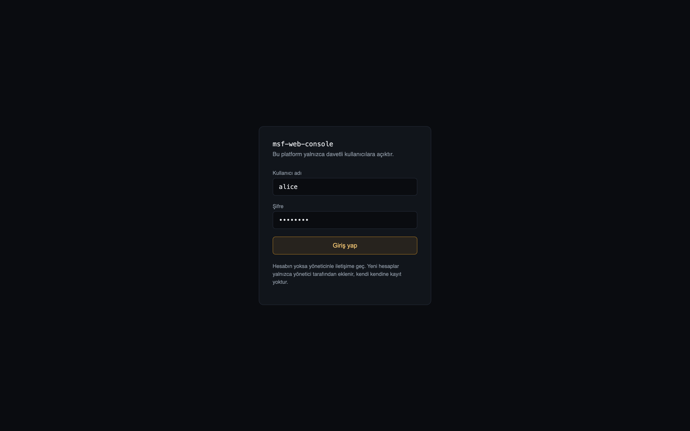

# MSF-Web-Console
Transforming the "Metasploit" tool into a live, web-based console project. This is intended solely for educational purposes. Any misuse is the responsibility of the user.

 

  
   

  
